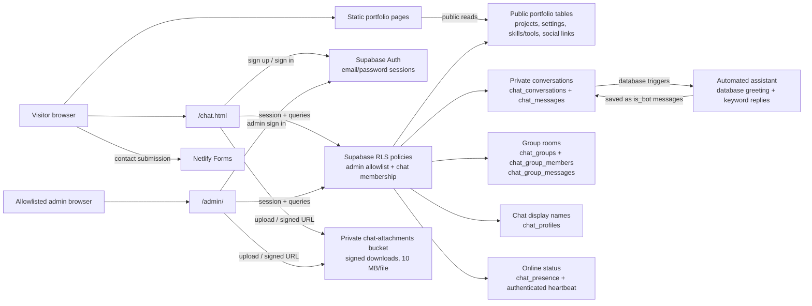

# MEPHISTO-BACK-SPELL

Personal portfolio website for a Java full-stack developer, built with HTML, CSS, and vanilla JavaScript. The site includes a login-protected visitor chat with private one-to-one conversations, invite-only group rooms, and photo/document attachments.

## Features

- Responsive portfolio pages for Home, About, Skills, Projects, Contact, and Chat.
- Theme selector and mobile navigation.
- Projects and portfolio content managed through a Supabase-backed Admin dashboard.
- Visitor email/password sign-up and sign-in for chat.
- Visitors can choose a 1–40 character chat display name; it is shown to other signed-in chat users.
- Private visitor-to-admin conversations and five seeded group rooms: General, Introductions, Projects, Questions, and Resources.
- Messages are stored in Supabase chat tables and persist across sign-ins; visitors and admins see online indicators based on authenticated presence heartbeats.
- Admin-created group rooms with UUID invite IDs, member management, and group messages.
- Private file sharing in direct and group conversations. Supported images and common documents are limited to 10 MB per file.
- Contact form handled by Netlify Forms after form detection is enabled.
- Search-engine sitemap at `/sitemap.xml`; private Admin and visitor chat pages are excluded from indexing.

## Local development

This is a static website; there is no package installation or build step. Serve the repository root using a local HTTP server or preview it through your editor. Use the deployed HTTPS site for testing Supabase Auth, email confirmation, database access, storage, and Netlify Forms. A `file://` preview does not support all of those integrations.

The root `sitemap.xml` lists the public portfolio pages, and `robots.txt` points crawlers to it while excluding Admin and visitor chat.

## Workflows

### Visitor chat

1. A visitor opens `/chat.html`, signs in, or creates an email/password account.
2. Supabase Auth issues the visitor's session. When email confirmation is enabled, the visitor confirms the email before signing in.
3. The chat page opens the visitor's private conversation and loads the group rooms that visitor has joined.
4. Visitors can edit their display name from the chat header. The name is stored in `chat_profiles` and displayed in messages and the Admin inbox; their login email remains private to the account and Admin inbox.
5. To join a group, the visitor enters an invite UUID supplied by the admin. Supabase validates the UUID and adds the signed-in visitor as a member.
6. Visitors and admins send text or optionally attach a supported photo/document (up to 10 MB). Messages persist in Supabase; the page polls periodically for new messages and refreshes online presence.
7. The allowlisted admin opens `/admin/`, selects a private conversation or group, replies, creates additional rooms, copies invite IDs, and removes group members.

### Portfolio content

1. Visitors read public portfolio content from the static pages and public Supabase tables.
2. The allowlisted admin signs in at `/admin/` to manage projects, skills/tools, social links, GitHub settings, and the resume.
3. Admin writes are authorized by Supabase row-level security (RLS); the browser uses only the public anon/publishable key.

### Contact form

1. A visitor submits the Netlify Forms form on `/contact.html`.
2. Netlify records the submission and, when configured, sends a notification to the portfolio owner's inbox.

## Architecture and data-flow map

### Chat access and message flow

| Action | Data flow | Access rule |
| --- | --- | --- |
| Start private chat | Visitor session → `chat_conversations` → `chat_messages` | Visitor can read/write their own conversation; allowlisted admin can reply. |
| Greet and auto-reply | New private conversation or visitor message → database trigger → `chat_messages` | Automated greeting and keyword-based answers are saved as bot messages; clients cannot mark their own messages as bot messages. |
| Join group | Visitor enters room UUID → `join_chat_group` RPC → `chat_group_members` | Signed-in user is added only to the matching room; the room ID acts as an invite. |
| Send group message | Member session → `chat_group_messages` | Only room members and allowlisted admins can read or send. |
| Show online status | Authenticated page → scoped presence RPCs → private `chat_presence` | Clients can mark only their own account online; visitors see only Admin status or a shared group's online count, and presence expires after 90 seconds. |
| Share attachment | Participant → private `chat-attachments` bucket → message attachment path → signed URL | Upload/download is limited by RLS to the conversation or group participants and admins. |
| Manage portfolio | Admin session → portfolio tables/storage | The verified Auth user UUID must be explicitly bound in `public.portfolio_admins`; database RLS is the authorization boundary. |

## Supabase setup

1. Create a Supabase project.
2. Run [`supabase/schema.sql`](./supabase/schema.sql) in the Supabase SQL Editor.
3. Run [`supabase/chat-migration.sql`](./supabase/chat-migration.sql). It creates the chat tables and policies, seeds five group rooms, creates the private attachment bucket, and adds visitor display-name profiles. Rerun it to apply updates to an existing project.
4. Run [`supabase/chatbot-migration.sql`](./supabase/chatbot-migration.sql) to enable the automatic direct-chat greeting and keyword replies.
5. Create your admin account through the Supabase Dashboard, verify its email, and bind its Auth user UUID in `public.portfolio_admins` as described at the end of `schema.sql`.
6. Enable email/password sign-up for visitors. If email confirmation is on, configure the Supabase Auth site URL and allow the deployed `/chat.html` URL as a redirect. Supabase's default email service may rate-limit sign-ups; configure custom SMTP for production.
7. Put your project URL and **public anon/publishable key** in [`supabase-config.js`](./supabase-config.js). Never put a Supabase service-role or secret key in browser code.
8. Deploy over HTTPS. Visitors use `/chat.html`; the allowlisted admin signs in at `/admin/`.

Only explicitly bound, email-confirmed admin user IDs can manage portfolio content and view the Admin chat inbox. Row-level security restricts conversations and attachments to their participants and admins. A group UUID is an invite ID: share it only with people you want to invite.

For an existing project, run [`supabase/admin-user-binding-migration.sql`](./supabase/admin-user-binding-migration.sql), then bind the intended admin's verified Auth user UUID. Email-only allowlist entries no longer grant access.

See [`supabase/SETUP.md`](./supabase/SETUP.md) for additional migrations and configuration, including social links, project imports, resume management, skills/tools, and contact form notifications.

For safe visitor demo-account setup and credential sharing, see [`DEMO-VISITOR-ACCESS.md`](./DEMO-VISITOR-ACCESS.md). No shared demo credentials are stored in this repository.

## Netlify contact form

Enable automatic form detection in Netlify and redeploy so the `portfolio-contact` form is registered. Configure a form notification to deliver messages to the portfolio owner's chosen inbox.
